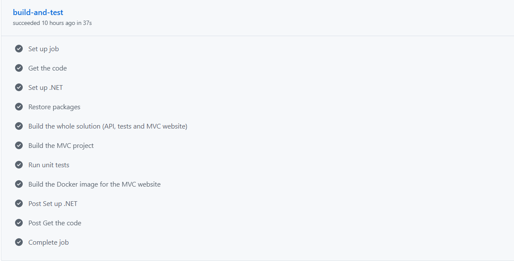

# RaceDay - Part 3: MVC Website, Azure Blob Storage and Docker

**Student:** Kitso Litelu (ST10486804)
**Branch for this part:** `part-3-mvc-docker`

**YouTube demo video (unlisted):** https://youtu.be/-a7jmEYPvls

RaceDay is a platform where **Organisers** create running, walking and cycling events and **Participants** enrol in them. Part 2 built the RESTful API. Part 3 adds an **ASP.NET Core MVC website** that uses that API for everything, stores event banners and profile pictures in **Azure Blob Storage** (through the API), and runs inside a **Docker** container.

## What is in this repository

| Folder / file | What it is |
|---|---|
| `RaceDayAPI_Pt2/` | The Part 2 RESTful API (ASP.NET Core, Entity Framework Core, SQL Server LocalDB) with the Part 3 additions |
| `RaceDayAPI_Pt2.Tests/` | xUnit tests for the API (54 tests) |
| `RaceDayWeb/` | The Part 3 ASP.NET Core MVC website, including its `Dockerfile` |
| `docker-compose.yml` | Starts the website in Docker with one command |
| `.github/workflows/dotnet.yml` | GitHub Actions: builds the solution and the MVC project, runs the tests, builds the Docker image |

## The two roles

**Organiser** (needs the organiser access code `RACEDAY-ORG-2026` when signing up)
- Dashboard: total events, upcoming events, enrolments per event and upcoming dates
- Create, edit and delete events (name, description, date, location, distance, event type), with a banner image upload
- Add categories (age or distance) to an event
- See every participant enrolled for an event, with their category and enrolment status
- Capture finish times and finishing positions after the event

**Participant**
- Home page with all upcoming events and filters (name, type, location)
- Event details page with the banner and the available categories
- Enrol in an event and choose a category
- My enrolments, with colour-coded statuses (green Confirmed, amber Pending)
- My results: event, date, category, finish time and position, for example "47th out of 312 finishers"
- Profile page: update name and email, and upload a profile picture

Each role has its own navigation menu. Pages that need a login send visitors to the login page, and a page that belongs to the other role shows an access-denied page. Logging out ends the session and redirects to the login page.

## How the MVC website works

- **No database code in the website.** `RaceDayWeb` never touches the database or Azure. One class, `Services/ApiClient.cs`, makes every call to the Part 2 API.
- **Session management.** On login the API sends back a cookie. The website keeps that cookie, the user's name and their role in its own ASP.NET Core session, and sends the API cookie with every later request. A filter (`Helpers/SessionAuthorizeAttribute.cs`) protects pages by login and role.
- **Folders.** `Controllers/` (page logic), `Views/` (Razor pages), `Models/Api` (JSON shapes sent by the API), `Models/ViewModels` (forms with validation), `Helpers/` and `Services/`.
- **Friendly errors.** Users never see raw error text. Failed API calls become short messages, and unexpected errors show an error page.
- **Styling.** Bootstrap 5 with a custom RaceDay theme (`wwwroot/css/site.css`).

## Azure Blob Storage (inside the API)

The API saves banner and profile images in Blob Storage using the official `Azure.Storage.Blobs` package (`Services/BlobStorageService.cs`). The website only sends the image to the API.

| Endpoint | Who | What it does |
|---|---|---|
| `POST /api/events/{id}/banner` | Organiser who owns the event | Uploads the event banner |
| `POST /api/users/me/picture` | Any logged in user | Uploads the profile picture |
| `GET /api/events/mine` | Organiser | Own events with enrolment counts (dashboard) |
| `GET /api/events?eventType=&location=&search=` | Everyone | Filtered list of upcoming events |

Images must be JPG, PNG or WEBP and 5 MB or smaller.

**Local storage emulator.** For development and the demo I use **Azurite**, Microsoft's official Azure Storage emulator, running in Docker. It works with the same code as real Azure. To use a real Azure Storage account instead, replace `BlobStorage:ConnectionString` in `RaceDayAPI_Pt2/appsettings.json` with the account's connection string (the storage account must allow anonymous blob access so the browser can show the images).

## How to run it

### Requirements
- Visual Studio 2022 or later with the .NET 10 SDK
- SQL Server LocalDB (installed with Visual Studio)
- Docker Desktop

### 1. Start Azure Blob Storage (Azurite)

```
docker run -d --name azurite -p 10000:10000 mcr.microsoft.com/azure-storage/azurite azurite-blob --blobHost 0.0.0.0 --skipApiVersionCheck
```

After a restart of Docker, start it again with `docker start azurite`.

### 2. Create the database

In Visual Studio open **Tools > NuGet Package Manager > Package Manager Console**, set **Default project** to `RaceDayAPI_Pt2` and run:

```
Update-Database
```

### 3. Run the API and the website locally

In Visual Studio right-click the solution, choose **Configure Startup Projects**, select **Multiple startup projects** and set `RaceDayAPI_Pt2` and `RaceDayWeb` to **Start**. Press **Start**.

- API and Swagger: `https://localhost:7189/swagger`
- Website: `https://localhost:7200`

### 4. Run the website in Docker (one command)

The API must be running (step 3), because the website gets all its data from it. Then, from the folder that contains `docker-compose.yml`:

```
docker compose up --build
```

Open `http://localhost:8080`. The container behaves the same as the local website. Stop it with `Ctrl+C` and `docker compose down`.

The same thing without Compose:

```
docker build -t raceday-web ./RaceDayWeb
docker run -p 8080:8080 -e ApiSettings__BaseUrl=https://host.docker.internal:7189 -e ApiSettings__TrustDevCertificate=true --add-host=host.docker.internal:host-gateway raceday-web
```

The `Dockerfile` uses a multi-stage build (SDK image to build, smaller ASP.NET runtime image to run), restores packages in a cached layer, and runs as a non-root user. `TrustDevCertificate` is a development-only setting so the container accepts the API's local development certificate.

## Try it quickly

1. Sign up as an **Organiser** with access code `RACEDAY-ORG-2026`, create an event with a banner and add a category.
2. Log out and sign up as a **Participant**, then enrol in the event.
3. Log in as the Organiser again, open the event's **Results** page and capture a finish time and position.
4. Log in as the Participant and open **My results**.

## Tests and CI/CD

- **54 xUnit tests** cover the API (authentication, roles, events, enrolments, results, image uploads, filters). Azure is replaced by a fake in the tests.
- The **GitHub Actions** workflow runs on every push. It restores packages, builds the whole solution, builds the MVC project, runs all the tests and builds the Docker image.



## Part 2

The Part 2 API (cookie-based session authentication, roles, enrolments, results, 44 unit tests) lives on the `part-2-restful-api` branch of this repository.
